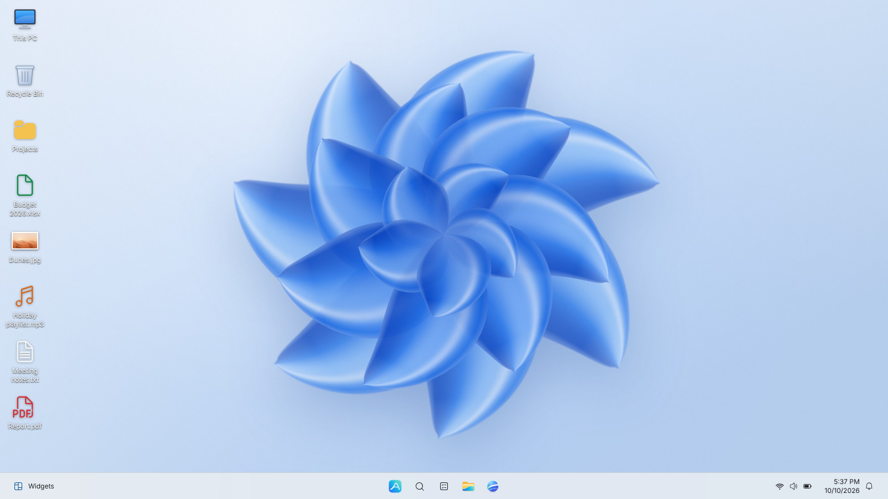

# Selene OS

A Windows 11–style desktop operating system you can boot live from an ISO and install in a virtual
machine. It is built on **Ubuntu 24.04 LTS**, with a fully custom desktop: the shell, the window
manager, the login screen and every app are written from scratch for Selene OS. Everything is
available in **English and French**, in light and dark themes.



## Features

**Desktop**
- Centered taskbar (or left-aligned), Start menu with pinned apps, all apps and recommended files
- Search, quick settings (Wi-Fi, volume, dark mode, night light, do not disturb), calendar and
  notification center, widgets
- Window manager drawn by the shell itself: open/close/minimize/maximize animations, edge snapping,
  Snap layouts, Snap assist, Alt+Tab, Task View with virtual desktops
- Windows 11-like visuals: Mica windows, acrylic blur, accent colors, original wallpapers, light/dark mode
- Keyboard shortcuts: Win, Win+D/E/I/L/A/N/S/R/X, Win+Tab, Win+arrows, Alt+Tab, Alt+F4,
  Ctrl+Shift+Esc, Ctrl+Alt+Del, PrintScreen / Win+Shift+S
- Login screen and lock screen with PAM authentication, "User Account Control" prompts for admin
  actions, firewall (ufw) enabled by default

**Personalization** (details in [docs/PERSONALIZATION.md](docs/PERSONALIZATION.md))
- Theme designer: accent color, wallpaper, lock screen, taskbar color, window transparency and blur intensity;
  font, text size, rounded corners, UI scale and reduced motion
- Five visual styles (Windows 11, Minimal, Glass, Retro, High contrast) and per-app light / dark / accent themes
- Animated wallpapers, and dynamic wallpapers that follow the time of day and the weather; slideshow
- Taskbar (size, position, icons, mini widgets, transparency, auto-hide) and Start menu (layouts, pinned apps,
  folders, recommended files, background style)
- Cursor, icon and sound packs, with custom notification, startup and shutdown sounds
- Custom snap layouts and fully customizable keyboard shortcuts
- Focus mode: hides notifications, dims the desktop and simplifies the taskbar, with a session timer
- Profiles: save the whole look and switch themes in one click; export and import

**Apps**

| App | Highlights |
|---|---|
| Selene Browser | Chromium engine, tabs, bookmarks bar and manager, history, downloads, private windows, find, zoom |
| File Explorer | Tabs, breadcrumb bar, copy/cut/paste, rename, delete to Recycle Bin, search, drives (mount/eject), properties |
| Mail | IMAP/SMTP accounts with provider presets (Gmail, Outlook, Yahoo, iCloud, Orange, Free…), compose, attachments, webmail shortcut |
| Paint | Brushes, shapes, fill, text, eraser, color picker, selection, undo/redo, PNG/JPEG/BMP/WebP save |
| Calculator | Standard, Scientific, Programmer, date calculation and unit converters, history and memory |
| Notepad | Tabs, find/replace, go to line, word wrap, encodings and line endings |
| Terminal | Real PTY with Bash, tabs, split panes, color schemes |
| Media Player | Music and video libraries, queue, playlists, audio visualizer, sample media included |
| Photos | Gallery by date, folders, favorites and albums; viewer with zoom and filmstrip, slideshow; editor with crop, straighten, adjustments and filters |
| PDF Reader | Tabs, page thumbnails and outline, find, zoom and page layouts, highlight and draw, presentation mode |
| Archive Manager | Browse, extract and create ZIP, 7z, RAR and TAR archives, password-protected archives, test and preview |
| Notes | Notebooks, rich text, checklists, pictures and tags, Markdown import/export, saved as you type |
| Calendar | Day, work week, week, month and agenda views, recurring events, reminders, holidays, .ics import/export |
| Clock | Alarms, timers, stopwatch, world clock and focus sessions; alarms ring even when the app is closed |
| To Do | Lists, My Day, reminders, due dates, repeats and steps |
| Snipping Tool | Rectangle/window/full-screen/free-form captures, markup, save and copy |
| Task Manager | Processes with heat map, live performance graphs, users, details, services |
| Settings | System, network, personalization, apps, accounts, time & language, accessibility, privacy & security, updates |
| Weather | Current conditions, 24-hour and 7-day forecasts, saved places; sets the dynamic wallpaper location |
| Maps | OpenStreetMap maps, place search, saved places |
| Contacts | People, e-mails, phones, addresses, birthdays, vCard import/export; suggestions in Mail |
| Sticky Notes | Colourful notes that can stay on top, saved as you type, copy to Notes |
| Translator | Seven languages (MyMemory or your LibreTranslate server), English dictionary, offline EN↔FR glossary |
| Remote Desktop | VNC client (RDP later) |
| Store | Command-line tools and services installed with apt (curated list) |
| Disks | Drives and partitions, mount and eject, format USB sticks and SD cards |
| Backup | Incremental snapshots of your folders to a drive; browse and restore |
| Passwords | Encrypted password vault with a generator |
| Cloud | Nextcloud / WebDAV files: browse, upload, download |
| Network tools | VPN and WireGuard connections, ping, DNS lookup |
| Games | Minesweeper, Solitaire, Snake, 2048, Chess (with a computer opponent) |
| Installer | Windows Setup–style installer: language, keyboard, disk, account, time zone |

## Quick start

You need a Linux host (Ubuntu or Debian recommended) with root access, about **25 GB** of free disk
space and **Node.js 22**. Full details are in [docs/BUILDING.md](docs/BUILDING.md).

```sh
# 1. Build tools
sudo apt-get install debootstrap ubuntu-keyring squashfs-tools xorriso mtools dosfstools \
     grub-common grub-pc-bin grub-efi-amd64-bin librsvg2-bin imagemagick unzip curl zstd git

# 2. Build the ISO  ->  out/selene-os-<version>-amd64.iso
cd aurora-os
sudo make iso

# 3. Try it in QEMU
sudo apt install qemu-system-x86 qemu-system-gui qemu-utils ovmf
make run          # BIOS firmware, live session + a 32 GB virtual disk to install to
make run-uefi     # same with UEFI firmware
```

No Ubuntu host? `make docker-iso` builds the ISO inside a privileged `ubuntu:24.04` container.

Use KVM for speed (`/dev/kvm` must be accessible: `sudo usermod -aG kvm $USER`). Without KVM, QEMU
still works, but the first boot takes several minutes.

Without the Makefile, this plain QEMU command does the same job (`make run DRY_RUN=1` prints the
exact command it uses):

```sh
qemu-img create -f qcow2 aurora-disk.qcow2 32G
qemu-system-x86_64 -enable-kvm -machine q35 -cpu host -m 4096 -smp 4 \
  -drive file=aurora-disk.qcow2,if=none,id=hd0,format=qcow2 -device virtio-blk-pci,drive=hd0,bootindex=1 \
  -drive file=out/selene-os-1.0.0-amd64.iso,if=none,id=cd0,media=cdrom,readonly=on -device ide-cd,drive=cd0,bootindex=2 \
  -vga none -device virtio-vga -device qemu-xhci -device usb-tablet \
  -nic user,model=virtio-net-pci \
  -audiodev pipewire,id=snd0 -device intel-hda -device hda-duplex,audiodev=snd0
```

The disk boots first. While it is still blank, the firmware falls through to the ISO; after
installation, the installed system starts even with the ISO attached.

## Installing in QEMU

1. Run `make run` and pick **Selene OS (English)** or **Selene OS (Français)** in the boot menu.
2. The live session signs in automatically. Open **Install Selene OS** from the desktop.
3. Choose language, keyboard, the virtual disk (it will be **erased**), your account and time zone,
   then click **Install**.
4. When it finishes, click **Restart now**. `make run` boots the installed disk first, so the ISO
   can stay attached. To boot only the disk later, use `make run-disk` (or `make run-disk-uefi`).
5. Sign in with the account you created.

## Project layout

```
aurora-os/
  shell/      Electron app: desktop shell, login screen and all built-in apps
  rootfs/     files copied into the OS image (session scripts, helpers, configs)
  iso/        ISO build scripts (debootstrap -> squashfs -> hybrid BIOS/UEFI ISO)
  tools/      QEMU launcher and helpers
  docs/       BUILDING.md (build, run, install), DEVELOPING.md (architecture, app API),
              PERSONALIZATION.md (themes, styles, wallpapers, taskbar, packs, profiles)
```

**Architecture:**
- Ubuntu 24.04 base (pinned archive snapshot for reproducible builds) with casper for the live session.
- greetd starts the Selene login screen. After sign-in, Xorg runs the fullscreen Electron shell, which
  draws the taskbar, the Start menu and every window.
- System features use standard Linux services: NetworkManager, PipeWire, udisks2, systemd-logind and
  ufw.

## Development

```sh
cd aurora-os/shell
npm ci
npx electron . --dev --no-sandbox               # run the desktop in a window
npx electron . --dev --no-sandbox --mode=greeter  # run the login screen
xvfb-run -a -s "-screen 0 1600x900x24" node test/smoke.mjs
```

Each app has its own Playwright test in `shell/test/`. See [docs/DEVELOPING.md](docs/DEVELOPING.md)
for the app contract, the UI kit and the backend API.

## License

The Selene shell, apps, scripts and artwork are released under the MIT license. Icons come from
Microsoft's Fluent UI System Icons (MIT). The base system is Ubuntu, and its components keep their
own licenses. Selene OS is not affiliated with Microsoft. "Windows" is a trademark of Microsoft
Corporation.
